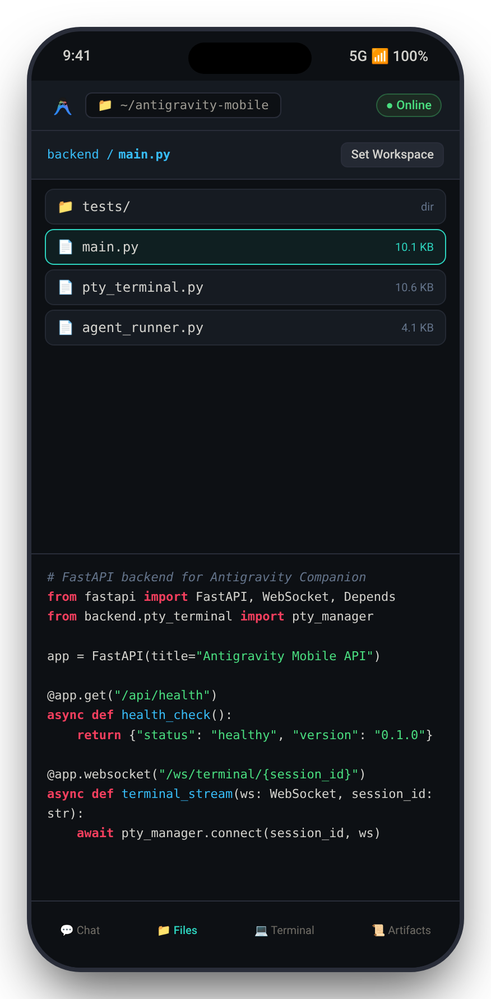

<p align="center">
  
</p>

# Antigravity Mobile Companion

A mobile-first web app and installable PWA for prompting, monitoring, and coding with your local **Antigravity** agents, files, and terminal directly from your phone.

<!-- Screenshots -->
<!--
Add mobile screenshots or a demo GIF here before publishing:
<p align="center">
  
  
  
</p>
-->

## Key Features

- **Agent Chat (IDE & CLI Sync):** Start new sessions or continue existing conversations synced directly with **Antigravity IDE**, **VS Code + Antigravity extension**, and the **`agy` CLI**. Stream thoughts and tool calls in real time, review artifacts, and approve or reject commands with one tap.
- **File Browser & Code Editor:** Browse project directories, switch active workspaces on the fly, view syntax-highlighted files, and make quick edits from your phone.
- **Multi-Tab PTY Terminal:** Full interactive Linux pseudo-terminal (`/bin/bash` over WebSockets with `xterm.js`), multiple terminal tabs, quick-command presets, and a touch toolbar (`ESC`, `TAB`, `CTRL+C`, arrow keys, and common symbols).
- **Installable Mobile PWA:** Works full-screen on iOS and Android via "Add to Home Screen" with no browser chrome.

## Prerequisites

- **Linux** (uses Linux PTYs and `bash`)
- **Python 3.10+**
- **Node.js 18+** (and `npm`)
- **`agy` CLI / Antigravity IDE** installed and authenticated on the host machine

## Quick Start

### One-Line Install & Launch

Clone and start in a single command:

```bash
git clone https://github.com/sann2sh/antigravity-mobile.git && cd antigravity-mobile && ./install.sh --start
```

*(Or run `./install.sh` to install dependencies first, then `./start.sh` whenever you want to run the server.)*

### Management Commands

| Command | Purpose |
| --- | --- |
| `./install.sh --start` | Install everything and immediately launch the server |
| `./start.sh` | Start the server (press `Ctrl+C` to stop) |
| `./start.sh --status` (or `-s`) | Check server health, active PIDs, auth status, and access URLs |
| `./uninstall.sh` | Stop the server and clean up `venv/`, `node_modules/`, and build artifacts |

---

## Connecting From Your Phone

### Option A: Same Wi-Fi Network (Zero Setup)

If your phone and computer are on the same Wi-Fi router:

1. Look at the terminal output when `./start.sh` starts — it will display your local network IP:
   ```
   📱 How to open on your phone:
     1. Same Wi-Fi Network:
        👉 http://192.168.x.x:8000
   ```
2. Open that URL directly in Safari (iOS) or Chrome (Android).

---

### Option B: Outside / Cellular / Different Network (Tailscale)

To securely access your terminal from anywhere in the world (coffee shop, cellular data, office) with automatic HTTPS:

1. **Install Tailscale** (free for personal use) on both your computer and phone:
   - Download from [tailscale.com](https://tailscale.com) and log in with the same account.
2. **Enable Tailscale Serve on your computer** (creates a secure HTTPS proxy with valid SSL certificates):
   ```bash
   tailscale serve --bg 8000
   ```
3. **Open the HTTPS address on your phone**:
   - Tailscale will print your private machine URL: `https://<your-computer>.<your-tailnet>.ts.net`.
   - Open it in your mobile browser.

---

### Installing as a Native Mobile App (PWA)

When accessed over HTTPS (via Tailscale Serve):

- **iOS (Safari):** Tap the **Share** button (box with arrow) -> select **"Add to Home Screen"** -> tap **Add**.
- **Android (Chrome):** Tap the three dots (**⋮**) -> tap **"Install app"** (or **"Add to Home screen"**).

The app will launch full-screen from your home screen just like a native iOS/Android application.

## Configuration & Security

You can configure the server using a `.env` file in the project root (see `.env.example` if provided):

| Variable | Description | Default |
| --- | --- | --- |
| `PORT` | Port the FastAPI server listens on | `8000` |
| `HOST` | Bind address for the server | `0.0.0.0` |
| `DEFAULT_WORKSPACE` | Initial workspace directory opened in the UI | Current working directory / `$HOME` |
| `MOBILETERMINAL_TOKEN` | Optional bearer token required to access API/WebSocket endpoints | Unset (auth disabled) |

> [!WARNING]
> **Security Note:** Antigravity Mobile Companion gives remote access to your local filesystem, shell (`/bin/bash`), and AI agents.
> - Keep the server on a **private network** (such as Tailscale or a trusted home LAN) — never expose it directly to the public internet.
> - Always set a strong `MOBILETERMINAL_TOKEN` in `.env` when using shared Wi-Fi or untrusted networks.

## Architecture

```
Phone (PWA Browser)
  │  HTTPS / WSS (Tailscale Serve or private LAN)
  ▼
FastAPI Server (backend/main.py)
  ├── Static SPA (frontend/dist)
  ├── Antigravity Sessions & Logs (~/.gemini/antigravity/)
  ├── Filesystem & Editor API
  ├── Multi-tab PTY Terminal (/bin/bash over WebSocket)
  └── Agent Runner (agy CLI)
```

## Contributing

Contributions are welcome! See [CONTRIBUTING.md](CONTRIBUTING.md) for local development setup and build instructions.
