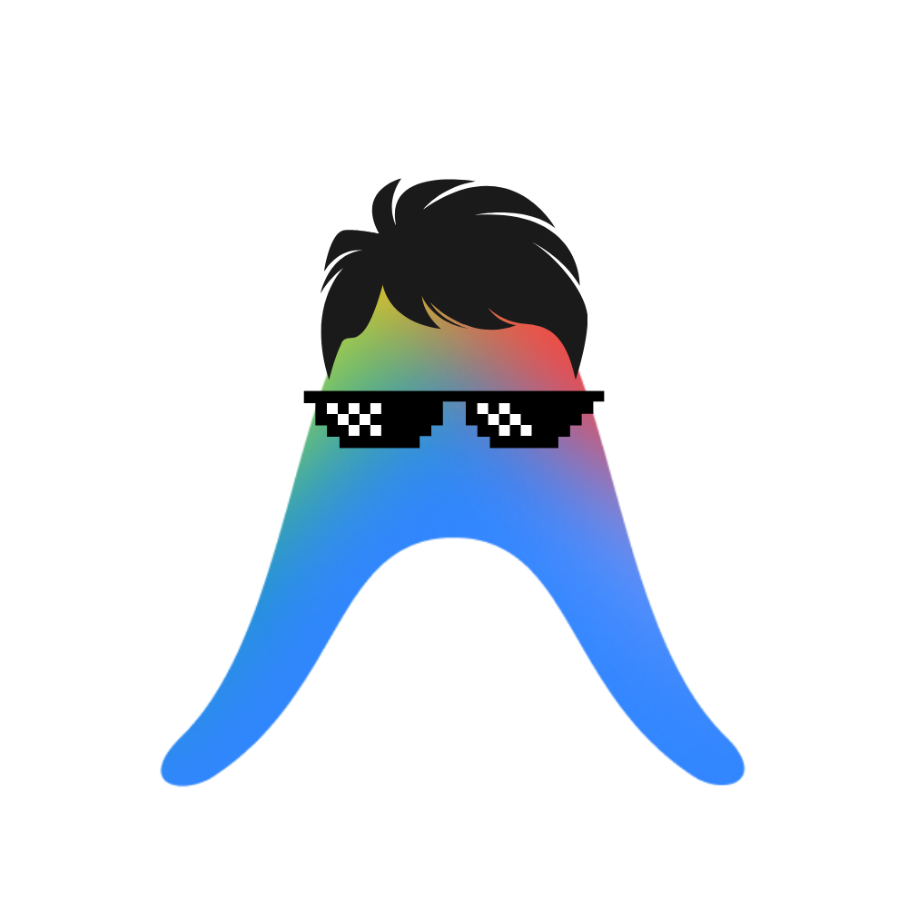
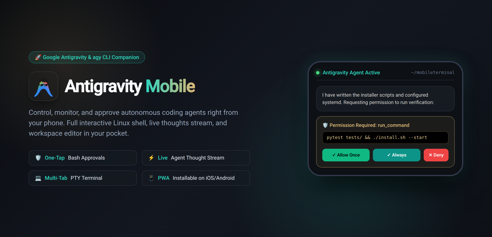
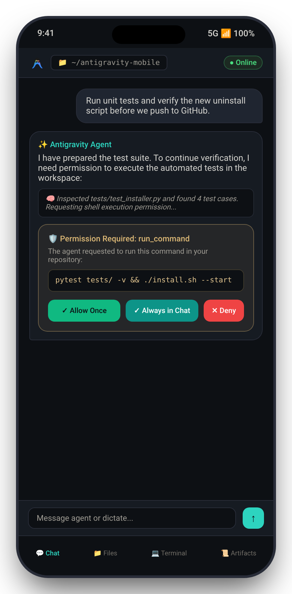
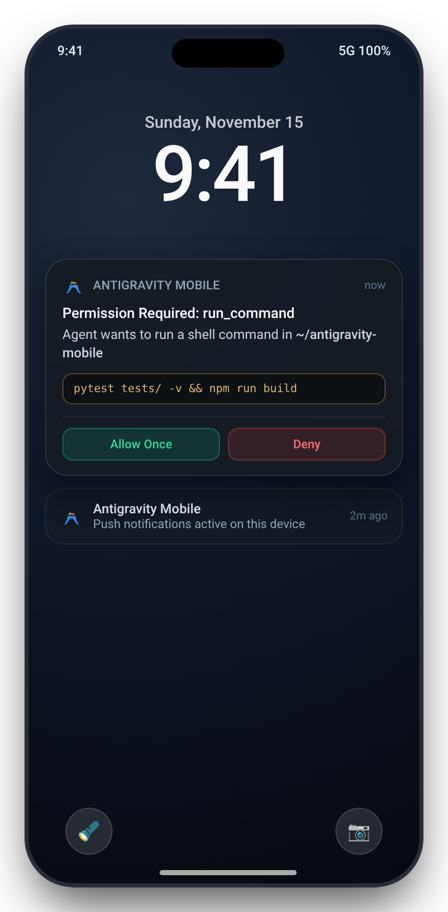
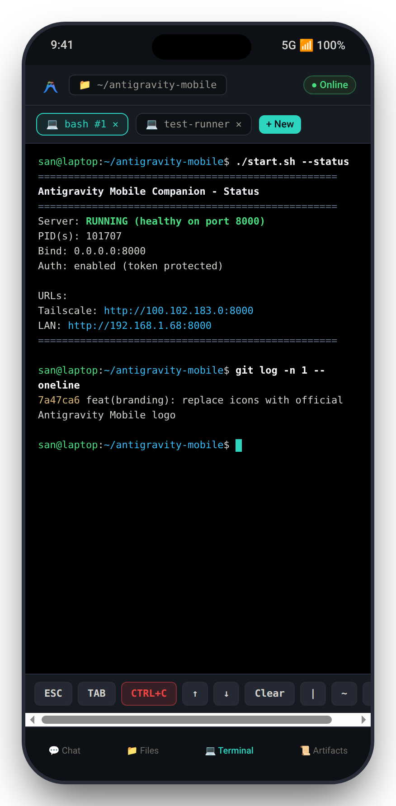

<p align="center">
  
</p>

<h1 align="center">Antigravity Mobile</h1>


<p align="center">
  <em>Tired of sitting at your desk and vibe coding? With this tool, vibe code whether you are walking, running, or running someone over.</em>
</p>


<p align="center">
  <strong>A mobile companion for Antigravity, VS Code and the <code>agy</code> CLI.</strong><br />
  Prompt agents, watch live thought streams, approve shell commands with one tap, browse workspaces, and run a real terminal from your phone.
</p>

<p align="center">
  <sub>This entire repo was created, debugged, and pushed completely using this tool. Full chicken and egg situation.</sub>
</p>


<p align="center">
  <a href="#quick-start"></a>
  <a href="LICENSE"></a>
  <a href="#compatibility"></a>
  <a href="#installing-as-a-native-mobile-app-pwa"></a>
</p>

<p align="center">
  
</p>

---

## Mobile Interface

<p align="center">
  
  &nbsp;&nbsp;
  
</p>
<p align="center">
  
  &nbsp;&nbsp;
  
</p>

<p align="center">
  <em><strong>Top:</strong> Live Agent Stream with One-Tap Allow/Deny Cards &bull; Lock-Screen Push Notifications<br /><strong>Bottom:</strong> Multi-Tab Terminal with Touch Toolbar &bull; Workspace File Browser & Editor</em>
</p>

---

## Compatibility

Antigravity Mobile is designed to plug directly into your existing setup with zero extra configuration:

- **Google Antigravity IDE:** Automatically picks up active conversation histories, session databases, and artifact files directly from `~/.gemini/antigravity/`.
- **VS Code with the Antigravity Extension:** Completely compatible. Any task started in VS Code can be monitored and continued on your phone, and actions started on your phone reflect in your local workspace.
- **The `agy` CLI:** Directly drives the `agy` agent engine under the hood (`agy -p ... --output-format stream-json`), supporting subagents, permission requests, and command execution.

---

## Features

- **Agent Chat & Live Streaming:** Stream thoughts and tool calls in real time over WebSockets. Review plans and artifacts without needing to open your laptop.
- **One-Tap Permission Cards:** When an agent needs to execute a terminal command (e.g. `npm run build` or `git status`), approve or reject it with a single tap: *Allow Once*, *Always in Chat*, or *Deny*.
- **Lock-Screen Push Notifications:** Tap the bell icon in the header (over HTTPS / Tailscale Serve) to get real VAPID Web Push alerts on your phone even when the screen is locked or the app is closed, with inline *Allow Once* / *Deny* actions and one-tap deep links straight to the prompt.
- **Voice Dictation:** Built-in microphone support via the Web Speech API so you can dictate complex prompts hands-free while away from your desk.
- **Multi-Tab Terminal:** A genuine Linux pseudo-terminal (`/bin/bash` over WebSockets via `xterm.js`) featuring tab management and mobile touch keys (`ESC`, `TAB`, `CTRL+C`, arrow keys, pipes, and slash).
- **Workspace File Browser:** Navigate your codebase, switch working directories on the fly, and inspect or edit files with syntax highlighting.
- **Installable PWA:** Runs full-screen on iOS Safari and Android Chrome with no browser address bars or navigation clutter.

---

## Quick Start

### One-Line Install & Launch

Clone the repository and launch the server in one command:

```bash
git clone https://github.com/sann2sh/antigravity-mobile.git && cd antigravity-mobile && ./install.sh --start
```

*(Or run `./install.sh` to install dependencies first, and `./start.sh` whenever you want to start the server.)*

### Management Commands

| Command | Purpose |
| --- | --- |
| `./install.sh --start` | Install all backend and frontend dependencies and immediately launch |
| `./start.sh` | Start the server (press `Ctrl+C` to stop) |
| `./start.sh --status` (or `-s`) | Check server health, active PIDs, auth status, and access URLs |
| `./uninstall.sh` | Stop the server and clean up `venv/`, `node_modules/`, and build artifacts |

---

## Connecting From Your Phone

### Option A: Same Wi-Fi Network (Zero Setup)

If your phone and computer are on the same Wi-Fi router:

1. When `./start.sh` runs, look at the local address printed in your terminal:
   ```
   How to open on your phone:
     1. Same Wi-Fi Network:
        http://192.168.x.x:8000
   ```
2. Open that URL directly in Safari (iOS) or Chrome (Android).

---

### Option B: Anywhere via Tailscale (Different Networks / Cellular)

To access your laptop safely from anywhere (coffee shops, cellular data, outside) with automatic HTTPS:

1. **Install Tailscale** on your computer and phone from [tailscale.com](https://tailscale.com) and log in with the same account.
2. **Enable Tailscale Serve** on your computer:
   ```bash
   tailscale serve --bg 8000
   ```
3. **Open the HTTPS address on your phone**:
   - Tailscale will print your private machine URL: `https://<your-computer>.<your-tailnet>.ts.net`.
   - Open it in your mobile browser.

---

### Installing as a Native Mobile App (PWA)

When accessed over HTTPS (via Tailscale Serve):

- **iOS (Safari):** Tap **Share** -> **Add to Home Screen** -> **Add**.
- **Android (Chrome):** Tap menu (**⋮**) -> **Install app** (or **Add to Home screen**).

The app launches full-screen directly from your home screen like a native app.

---

## Configuration & Security

The server is configured via `.env` in the project root (see `.env.example`):

| Variable | Description | Default |
| --- | --- | --- |
| `PORT` | Port the FastAPI server listens on | `8000` |
| `HOST` | Bind address for the server | `0.0.0.0` |
| `DEFAULT_WORKSPACE` | Initial workspace directory opened in the UI | Current working directory / `$HOME` |
| `MOBILETERMINAL_TOKEN` | Optional bearer token required to access API and WebSocket endpoints | Unset (auth disabled) |

> [!WARNING]
> **Security Note:** Antigravity Mobile gives remote access to your local filesystem, shell (`/bin/bash`), and AI agents.
> - Keep the server on a **private network** (such as Tailscale or a trusted home LAN) — never expose it directly to the public internet.
> - Set a strong `MOBILETERMINAL_TOKEN` in `.env` if using shared Wi-Fi.

---

## Architecture

```
Phone (PWA Browser)
  │  HTTPS / WSS (Tailscale Serve or private LAN)
  ▼
FastAPI Server (backend/main.py)
  ├── Static SPA (frontend/dist)
  ├── Antigravity Sessions & Logs (~/.gemini/antigravity/)
  ├── Filesystem & Editor API
  ├── Multi-tab PTY Terminal (/bin/bash over WebSocket)
  └── Agent Runner (agy CLI)
```

---

## Contributing

Contributions and feedback are welcome. See [CONTRIBUTING.md](CONTRIBUTING.md) for local dev setup and build instructions. License: [MIT](LICENSE).
